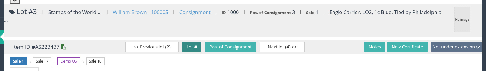
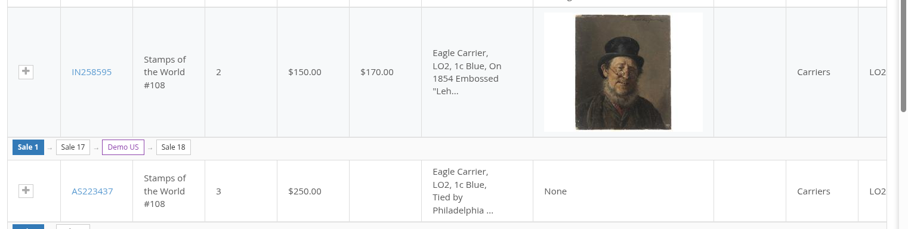
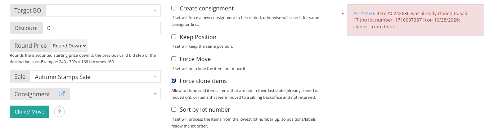
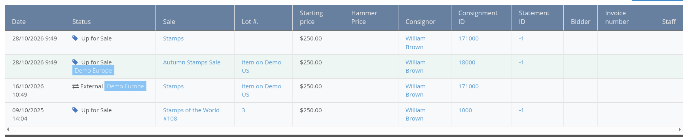
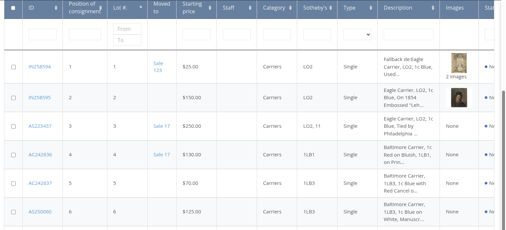

<!-- i18n source=items/clone-move-between-sales-and-backoffices.md sha=90dfd833e98a -->
# Los zwischen Auktionen und Backoffices klonen oder verschieben

Ein Los, das nicht verkauft wurde, wird in der Regel erneut angeboten: Es wird in eine spätere Auktion **geklont** oder dorthin **verschoben**, wenn in der ersten Auktion noch nichts davon abhängt. Betreibt Ihr Auktionshaus mehrere Backoffices (zum Beispiel eines je Land), kann ein Los auch an ein verbundenes Backoffice gesendet, dort angeboten und später zurückgeholt werden. Das Backoffice merkt sich den gesamten Weg des Loses, seine **Kette**, und entscheidet anhand dieser Kette, welche Kopie des Loses als Nächstes geklont oder verschoben werden darf.

## Die Kette eines Loses

Jedes Klonen und jedes Verschieben fügt der Kette eines Loses ein Glied hinzu: von der Auktion, in der es zuerst angeboten wurde, über jede spätere Auktion und über jedes Backoffice, an das es gesendet wurde. Die Kette wird an vier Stellen angezeigt.

1. Auf der Losseite, unter der Los-Navigation **\[1\]**: ein Kästchen je Auktion, die älteste zuerst, wobei die Auktion, in der das Los geöffnet ist, hervorgehoben ist. Ein dunkleres Kästchen ist ein Backoffice, an das das Los gesendet wurde. Jedes Kästchen öffnet das Los in dieser Auktion oder in diesem Backoffice. Der Kopfbereich zeigt zudem **Cloned from**, wenn das Los aus einem anderen Los oder von einem verbundenen Backoffice stammt.

1. Im Tab **Losverlauf** der Losseite (siehe [den Tab Losverlauf](#der-tab-losverlauf-über-backoffices-hinweg) weiter unten).
2. Im Tab **Alle Lose (Stammbaum)** einer Einlieferung: Die Kette wird in einer Zeile über jedem Los gezeichnet, das unterwegs war **\[2\]**, sodass die Lose der ursprünglichen Einlieferung bis dorthin verfolgt werden können, wo sie jetzt angeboten werden.

1. In der Losliste, in der Spalte **Moved to** (siehe [die Spalte Moved to](#die-spalte-moved-to-der-losliste) weiter unten).

Eine Kette wird von dem Los aus gelesen, das Sie gerade betrachten, und von den verbundenen Backoffices, die es nennt; sie sieht daher von jedem Glied aus und in jedem Backoffice gleich aus.

## Regeln für Klonen und Verschieben

Wählen Sie die Lose in der Losliste aus, öffnen Sie den Block **Los klonen/ verschieben**, wählen Sie die Zielauktion und die Optionen und klicken Sie auf **Clone/ Move**. Je Los läuft eine Aufgabe in der Warteschlange, in der Reihenfolge, in der die Lose gesendet wurden, und der Block meldet das Ergebnis jedes Loses mit einem Link zum neuen Los. Ein Stapel, der an ein verbundenes Backoffice gesendet wurde, wartet auf der anderen Seite, bis ihn dort jemand in eine Auktion seiner Wahl freigibt (siehe [Verbundene Backoffices](/de/release-notes/version-3.1.md)).

Ob geklont oder verschoben: Ein Los wird nur vom **neuesten Glied seiner Kette** genommen, und nur solange es noch zum Verkauf steht:

1. Ein Los, das bereits weitergeklont oder an ein verbundenes Backoffice verschoben wurde, ist in seiner Auktion gesperrt. Die Anfrage wird mit einer Meldung abgelehnt, die das neuere Los und den Tag des Klonens nennt, oder das Backoffice, an das es gesendet wurde; klonen Sie es stattdessen von dort **\[3\]**.
2. Nur Lose mit dem Status **unverkauft** oder **Zum Verkauf** können geklont oder verschoben werden.
3. Ein Los mit dem Status **Verkauft** wird nie verschoben: Seine Rechnung würde es verlieren. Klonen Sie es stattdessen.

**Force clone items** **\[4\]** hebt die ersten beiden Regeln auf, nur für das Klonen: Damit können ein verkauftes Los, ein Los, das nicht das neueste Glied seiner Kette ist, und ein Los, das an ein verbundenes Backoffice gesendet und nicht zurückgeholt wurde, geklont werden. Verwenden Sie die Option, wenn Sie wirklich eine zweite Kopie eines älteren Glieds wollen, zum Beispiel um ein verkauftes Los nach dem Storno des Zuschlags erneut anzubieten.

Das Fragezeichen neben der Schaltfläche **Clone/ Move** öffnet **Clone/ Move information**: die Liste der Bedingungen, unter denen ein Los verschoben statt geklont wird, und diese Regeln.


Beim Verschieben bleiben das Los und sein Verlauf erhalten, nur die Auktion ändert sich; beim Klonen entsteht ein neues Los, das sich merkt, woher es stammt. Das Backoffice verschiebt ein Los nur, wenn sich sein Verkaufsstatus nie geändert hat, seine Einlieferungsabrechnung noch offen ist, die Auktion noch nicht begonnen hat und das Los auf dem Bid-Server nicht zum Bieten geöffnet ist. Andernfalls klont es.


## Der Tab Losverlauf über Backoffices hinweg

Der Tab **Losverlauf** eines Loses listet die Verlaufszeilen jedes Glieds der Kette auf: jedes Angebot des Loses mit Auktion, Losnummer, Preisen, Einlieferung und, sobald verkauft, Bieter und Rechnung.

Eine Zeile, die ein Verschieben zu oder von einem verbundenen Backoffice festhält, trägt neben dem Status das Kennzeichen des Backoffice, zu dem sie gehört **\[5\]**, und ihre Losspalte verlinkt auf das Los im anderen Backoffice. Sind die beiden Backoffices verbunden, werden auch die Verlaufszeilen abgerufen und aufgelistet, die das andere Backoffice zu dem Los hält, mit dessen Kennzeichen, sodass der gesamte Weg an einer Stelle nachzulesen ist. Das Kennzeichen Ihres eigenen Backoffice verwendet den Namen aus den Server Settings (**Backoffice name**).

## Die Spalte Moved to der Losliste

Im Auktionskontext einer Auktion zeigt die Spalte **Moved to** der Losliste, wohin jedes Los dieser Auktion gegangen ist: leer bei einem Los, das geblieben ist, ein Auktionskästchen mit Link auf den Klon in der späteren Auktion oder ein Backoffice-Kästchen, wenn das Los an ein verbundenes Backoffice gesendet wurde.

Die Spalte wird in den Server Settings eingeschaltet: Fügen Sie `moved_to` zu **List of column in item table** hinzu. Wie die anderen Spalten wird sie dann in der Reihenfolge dieser Liste angezeigt.

## Vor dieser Version geklonte Lose

Lose, die vor Version 3.6 geklont oder an ein verbundenes Backoffice gesendet wurden, funktionieren weiterhin: Ihr Eintrag **Cloned from** und ihr Eintrag zum verbundenen Backoffice werden beim Update des Backoffice in die Kette übernommen, sodass ihre Kette, ihre Verlaufszeilen und ihre Zellen in Moved to genauso aussehen wie bei neuen Klonen. Nichts muss wiederholt werden.

Siehe auch [Mehrere Lose einer Auktion zuweisen](/de/sale/how-to-assign-bulk-items-to-a-sale.md) und [Bestehendes Los finden](/de/items/how-to-find-an-existing-item.md).
