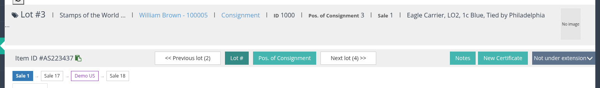
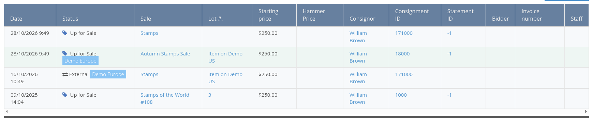
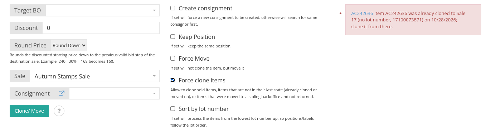
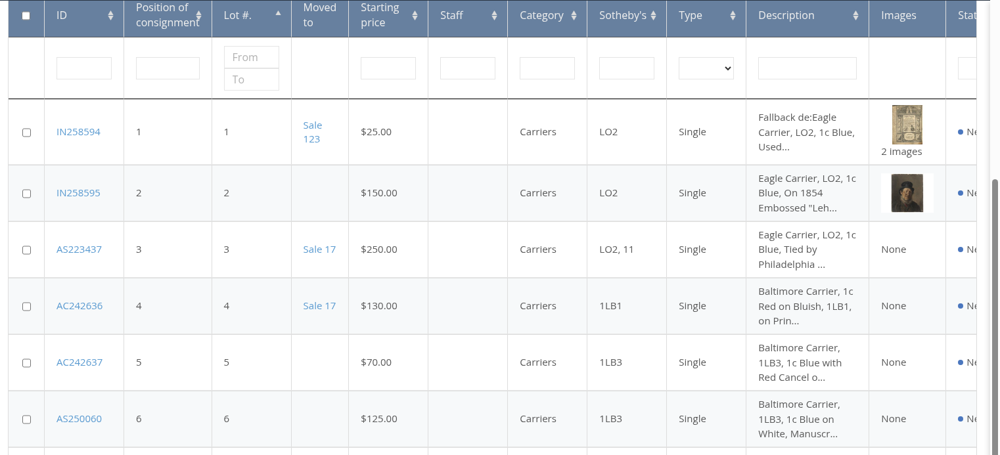
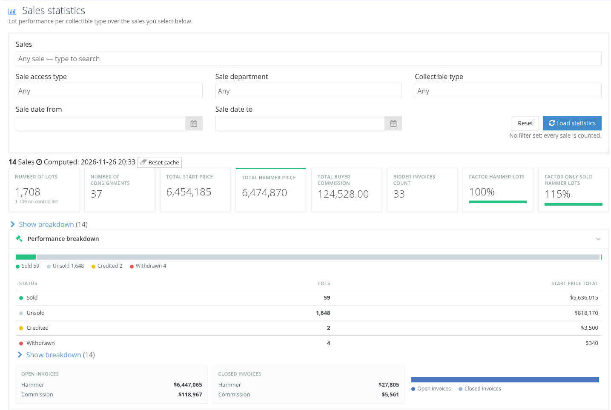
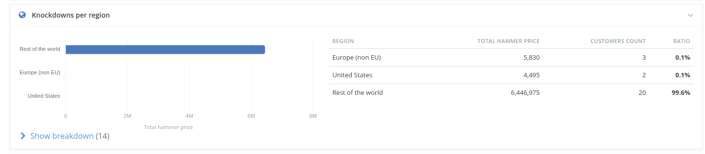
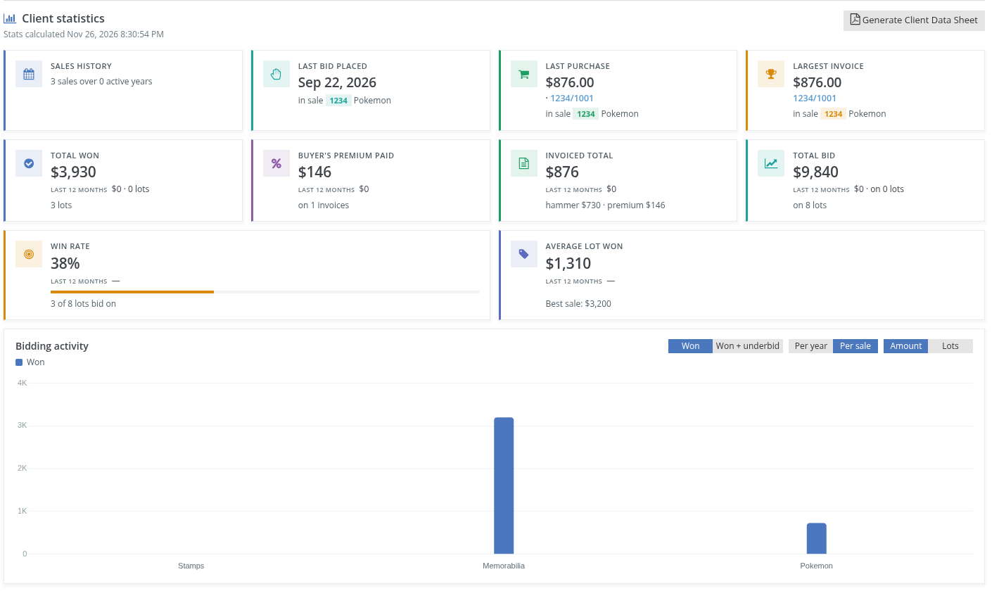
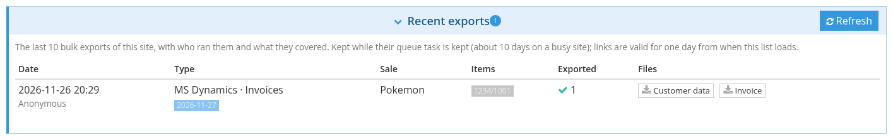
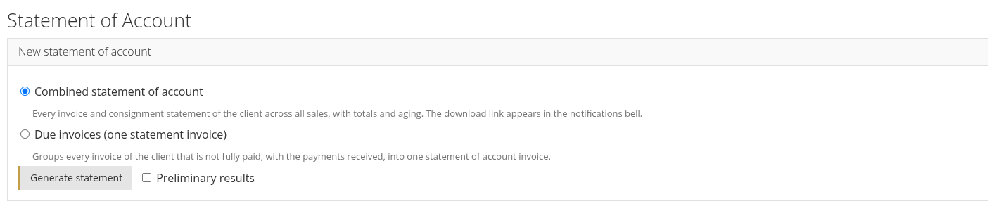

<!-- i18n source=release-notes/version-3.6.md sha=8f8e5e2e27fb -->
# Version 3.6

Kommendes Release. Version 3.6 folgt einem Los, wohin es auch geht: Ein Los, das in eine spätere Auktion geklont oder verschoben, an ein verbundenes Backoffice gesendet oder von dort zurückgeholt wird, zeigt jetzt seine gesamte Kette auf der Losseite, im Stammbaum und in der Losliste; sein Verlaufs-Tab liest über Backoffices hinweg, und die Regeln für Klonen und Verschieben stellen sicher, dass ein Los immer von seinem neuesten Glied genommen wird. Klon- und Verschiebe-Stapel laufen über die Warteschlange, ein Los nach dem anderen, und melden jedes Ergebnis auf der Losliste. Bei den Auswertungen fasst eine neue Seite „Sales statistics“ mehrere Auktionen auf einmal zusammen, die Kundenstatistiken zeigen mehr Zahlen, „Export Accounting“ listet die letzten Exporte mit ihren Dateien auf, und die offenen Rechnungen eines Kunden lassen sich in einem neuen Kontoauszug zusammenfassen.

## Lose

### Die Kette eines Loses auf der Losseite und im Stammbaum

Jedes Klonen und jedes Verschieben fügt der **Kette** eines Loses ein Glied hinzu: die Auktionen, in denen es angeboten wurde, und die Backoffices, an die es gesendet wurde.

- Auf der Losseite wird die Kette unter der Los-Navigation als Reihe von Kästchen gezeichnet, die älteste Auktion zuerst, mit der Auktion hervorgehoben, in der das Los geöffnet ist. Ein dunkleres Kästchen ist ein verbundenes Backoffice. Jedes Kästchen öffnet das Los in dieser Auktion oder in diesem Backoffice.
- Der Kopfbereich des Loses zeigt **Cloned from** bei einem Los, das aus einem anderen Los oder von einem verbundenen Backoffice stammt.
- Im Tab **Alle Lose (Stammbaum)** einer Einlieferung wird dieselbe Kette in einer Zeile über jedem Los gezeichnet, das unterwegs war.
- Eine Kette ist von jedem Glied aus und in jedem Backoffice dieselbe: Das Backoffice fragt seine verbundenen Backoffices nach ihrem Teil der Kette.

Siehe [Los zwischen Auktionen und Backoffices klonen oder verschieben](/de/items/clone-move-between-sales-and-backoffices.md).

### Losverlauf über Backoffices hinweg

Der Tab **Losverlauf** listet die Verlaufszeilen jedes Glieds der Kette auf. Eine Zeile, die ein Verschieben zu oder von einem verbundenen Backoffice festhält, trägt neben dem Status das Kennzeichen des Backoffice, zu dem sie gehört, und verlinkt auf das Los im anderen Backoffice; sind die Backoffices verbunden, werden auch die Zeilen abgerufen und aufgelistet, die das andere Backoffice hält, mit dessen Kennzeichen. Eine neue Einstellung **Backoffice name** (Server Settings, General) benennt dieses Backoffice auf diesen Kennzeichen.

### Regeln für Klonen und Verschieben und „Force clone items“

Ein Los wird nur vom **neuesten Glied seiner Kette** geklont oder verschoben, und nur solange es noch zum Verkauf steht:

- Ein Los, das bereits weitergeklont wurde oder an ein verbundenes Backoffice gesendet wurde, wird mit einer Meldung abgelehnt, die das neuere Los und den Tag des Klonens nennt, oder das Backoffice, an das es gesendet wurde.
- Nur Lose mit dem Status **unverkauft** und **Zum Verkauf** können geklont oder verschoben werden; ein Los mit dem Status **Verkauft** wird nie verschoben, weil seine Rechnung es verlieren würde.
- **Force clone items** hebt diese Regeln auf, nur für das Klonen.
- Das Popover **Clone/ Move information** (das Fragezeichen neben der Schaltfläche) listet jetzt diese Regeln zusammen mit den Bedingungen für ein Verschieben auf.

Lose, die vor dieser Version geklont wurden, funktionieren weiterhin: Ihre alten Einträge werden beim Update des Backoffice in die Kette übernommen.

### Klon- und Verschiebe-Stapel über die Warteschlange

Anfragen zum Klonen und Verschieben aus der Losliste laufen jetzt als eine Warteschlangen-Aufgabe je Los, in der Reihenfolge, in der die Lose gesendet wurden, sowohl in diesem Backoffice als auch zwischen verbundenen Backoffices. Der Block **Los klonen/ verschieben** verfolgt den Stapel live: Zähler für ausstehend, laufend, erledigt und fehlgeschlagen sowie eine Zeile je Los mit seinem Ergebnis und einem Link zum neuen Los. Ein Stapel, der an ein verbundenes Backoffice gesendet wurde, wartet dort als „pending“, bis ein Benutzer dieses Backoffice die Klon-Seite öffnet und ihn in eine Auktion seiner Wahl freigibt, mit den dort gewählten Optionen für Einlieferung, Nachlass und Rundung; ein nicht freigegebener Stapel verfällt nach sieben Tagen.

### Spalte „Moved to“ in der Losliste

Eine neue Spalte **Moved to** der Losliste zeigt im Auktionskontext einer Auktion, wohin jedes Los gegangen ist: leer bei einem Los, das geblieben ist, ein Link auf den Klon in der späteren Auktion oder das verbundene Backoffice, an das es gesendet wurde. Fügen Sie `moved_to` zu **List of column in item table** in den Server Settings hinzu, um sie anzuzeigen.

## Auswertungen und Statistiken

### Verkaufsstatistik über mehrere Auktionen

Eine neue Seite **Sales statistics** (Seitenleiste, unter Auswertungen) fasst die Ergebnisse der Lose mehrerer Auktionen auf einmal zusammen.

- Wählen Sie die Auktionen einzeln aus oder filtern Sie sie nach **Sale access type**, **Sale department**, **Collectible type** und Auktionsdatum (**Sale date from** / **Sale date to**), und klicken Sie dann auf **Load statistics**. Ohne Filter wird jede Auktion gezählt.
- Kennzahlkarten: Anzahl der Lose (und Lose auf der Kontrollliste), Anzahl der Einlieferungen, Gesamtsumme der Startpreise, Gesamtsumme der Zuschläge, gesamte Käuferprovision, Anzahl der Auktionsfakturen sowie der Zuschlagsfaktor über alle Lose und nur über verkaufte Lose.
- **Performance breakdown**: verkaufte, unverkaufte, gutgeschriebene und zurückgezogene Lose mit ihren Startpreissummen sowie Zuschlag und Provision der offenen und der abgeschlossenen Rechnungen.
- **Performance by collectible type**: dieselbe Aufschlüsselung mit einem Tab je Sammelobjekttyp.
- **Knockdowns per region**, **Turnover by Bidder Invoices** in Preisstufen und ein **Categories breakdown** nach Einzellosen, Sammlungen und Gruppen.
- Jeder Block hat einen Link **Show breakdown**, der seine Zahlen je Auktion aufteilt.
- Die Ergebnisse werden zwischengespeichert; die Zeile über den Karten zeigt, wann sie berechnet wurden, und **Reset cache** berechnet sie neu.

### Mehr Kundenstatistiken

Der Tab **Statistiken** der Kundenseite zeigt weitere Zahlen:

- Neue Karten: **Sales history** (Anzahl der Auktionen und aktiven Jahre), **Last bid placed**, **Last purchase** und **Largest invoice**, jeweils mit der Auktion und einem Link zur Rechnung, **Buyer's premium paid** und **Invoiced total** (aufgeteilt in Zuschlag und Aufgeld).
- **Gesamt gewonnen**, Aufgeld, Rechnungssumme, **Gesamt geboten**, **Erfolgsquote** und **Ø gewonnenes Los** zeigen jetzt auch den Wert der **letzten 12 Monate**. **Ø gewonnenes Los** zeigt zudem die beste Auktion.

## Buchhaltung

### Letzte Exporte unter „Export Accounting“

Die Seite **Export Accounting** hat über den Filtern ein Panel **Recent exports**. Es listet die letzten 10 Sammelexporte der Website auf: Datum und Benutzer, der den Export ausgeführt hat, Exporttyp und Exportdatum, die Auktion, die exportierten Rechnungen oder Abrechnungen, die Anzahl der exportierten Einträge und Download-Links zu den erzeugten Dateien. Ein Export bleibt aufgeführt, solange seine Aufgabe in der Warteschlange aufbewahrt wird (etwa 10 Tage auf einer stark genutzten Website), und die Datei-Links sind einen Tag ab dem Laden der Liste gültig. **Aktualisieren** lädt die Liste neu.

Siehe [Buchhaltung exportieren](/de/tutorials/export-dynamics.md).

### Neuer Kontoauszug auf der Kundenseite

Der Tab **Kontoauszug** der Kundenseite hat ein Panel **New statement of account** mit zwei Optionen:

- **Combined statement of account**: alle Rechnungen und Einlieferungsabrechnungen des Kunden über alle Auktionen, mit Summen und Altersstruktur. Der Download-Link erscheint in der Benachrichtigungsglocke.
- **Due invoices (one statement invoice)**: fasst alle nicht vollständig bezahlten Rechnungen des Kunden mit den erhaltenen Zahlungen in einer Kontoauszugsrechnung zusammen, sodass der Kunde eine Übersicht über alle offenen Rechnungen erhält.

Setzen Sie ein Häkchen bei **Preliminary results**, um den Auszug vor dem Erzeugen in der Vorschau zu sehen.

## Datenmigration

### Verbundene Lose bei Kelleher

Lose, die in einer späteren AMS-Auktion erneut angeboten wurden, werden jetzt als Glieder der Los-Kette importiert statt als separate Verbindungseinträge, sodass migrierte Lose dieselbe Kette, dieselben Verlaufszeilen und dieselben Zellen in Moved to zeigen wie im Backoffice geklonte Lose.
