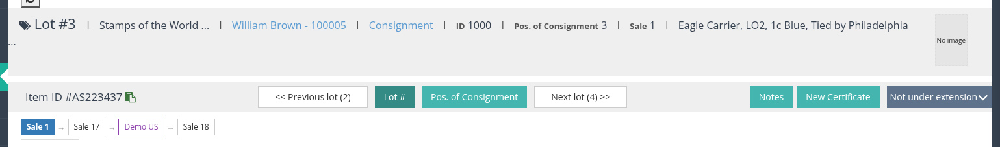
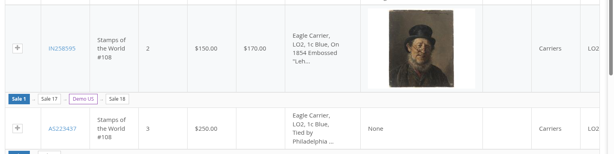
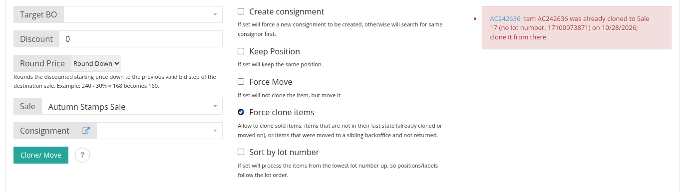
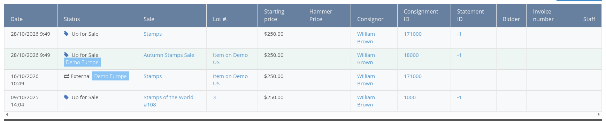
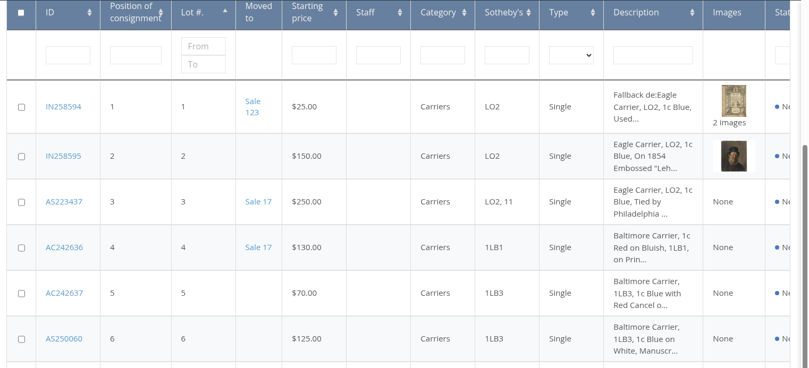

# Clone or Move an Item Between Sales and Backoffices

A lot that did not sell is usually offered again: it is **cloned** into a later sale, or **moved** there when nothing in the first sale depends on it yet. When your auction house runs several backoffices (for example one per country), a lot can also be sent to a sibling backoffice and offered there, and later come back. The backoffice keeps the whole journey of the lot, called its **chain**, and uses it to decide which copy of the lot may be cloned or moved next.

## The chain of an item

Every clone or move adds a link to the chain of the lot: from the sale it was first offered in, through each later sale, and through each backoffice it went to. The chain is shown in four places.

1. On the item page, under the lot navigation **\[1\]**: one box per sale, oldest first, with the sale the item is open in highlighted. A darker box is a backoffice the lot went to. Each box opens the lot in that sale or on that backoffice. The header also shows **Cloned from** when the lot came from another lot or from a sibling backoffice.

1. In the **Item History** tab of the item page (see [the history tab](#the-item-history-tab-across-backoffices) below).
2. In the **All Items (Family Tree)** tab of a consignment: the chain is drawn in a row above each lot that travelled **\[2\]**, so the lots of the original consignment can be followed to wherever they are offered now.

1. In the items list, in the **Moved to** column (see [the Moved to column](#the-moved-to-column-of-the-items-list) below).

A chain is read from the lot you are looking at and from the sibling backoffices it names, so it looks the same from every link, on every backoffice.

## Clone or move rules

Select the lots on the items list, open the **Clone/ Move Item** block, choose the destination sale and the options, and click **Clone/ Move**. One task per lot runs in the queue, in the order the lots were sent, and the block reports the result of each lot with a link to the new lot. A batch sent to a sibling backoffice waits on the other side until someone there releases it into a sale of their choice (see [Connected backoffices](../release-notes/version-3.1.md)).

Whether cloned or moved, a lot is taken only from the **newest link of its chain**, and only when it is still for sale:

1. A lot that was already cloned on, or moved to a sibling backoffice, is locked in its sale. The request is refused with a message naming the newer lot and the day it was cloned, or the backoffice it went to; clone it from there instead **\[3\]**.
2. Only lots in the **Unsold** or **Up for sale** statuses can be cloned or moved.
3. A **Sold** lot is never moved: its invoice would lose it. Clone it instead.

**Force clone items** **\[4\]** lifts the first two rules, for cloning only: it allows a sold lot, a lot that is not the newest link of its chain, and a lot that left to a sibling backoffice and has not come back, to be cloned. Use it when you really want a second copy of an older link, for example to offer a sold lot again after the sale was cancelled.

The question mark next to the **Clone/ Move** button opens **Clone/ Move information**, the list of conditions under which a lot is moved rather than cloned, and these rules.


A move keeps the lot and its history and changes its sale; a clone creates a new lot that remembers where it came from. The backoffice moves a lot only when its sold status never changed, its consignment statement is still open, the sale has not started, and the lot is not open for bidding on the bid server. Otherwise it clones.


## The Item History tab across backoffices

The **Item History** tab of an item lists the history rows of every link of the chain: each time the lot was offered, with the sale, the lot number, the prices, the consignment and, once sold, the bidder and the invoice.

A row that records a move to or from a sibling backoffice carries, next to the status, the badge of the backoffice it belongs to **\[5\]**, and its lot column links to the lot on the other backoffice. When the two backoffices are connected, the history rows the sibling holds for the lot are fetched and listed as well, with the sibling's badge, so the whole journey can be read from one place. The badge of your own backoffice uses the name set in the Server Settings (**Backoffice name**).

## The Moved to column of the items list

In the sale context of a sale, the **Moved to** column of the items list shows where each lot of that sale went: empty for a lot that stayed, a sale box linking to the clone in the later sale, or a backoffice box when the lot left to a sibling backoffice.

The column is switched on in the Server Settings: add `moved_to` to **List of column in item table**. Like the other columns, it is then shown in the order of that list.

## Lots cloned before this version

Lots cloned or sent to a sibling before version 3.6 keep working: their **Cloned from** record and their connected-backoffice record are read into the chain when the backoffice is updated, so their chain, history rows and Moved to cells look the same as those of new clones. Nothing needs to be redone.

See also [How to Assign Bulk Items to a Sale](../sale/how-to-assign-bulk-items-to-a-sale.md) and [How to Find an Existing Item](how-to-find-an-existing-item.md).
