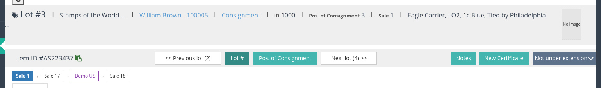
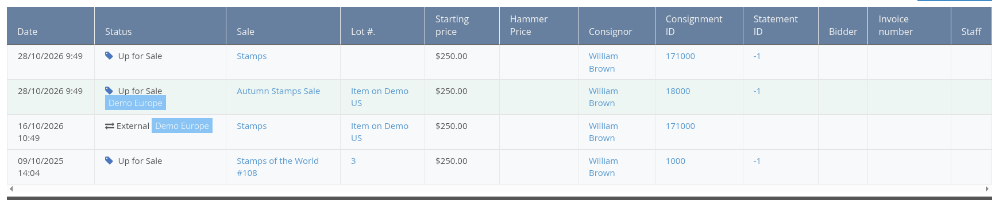
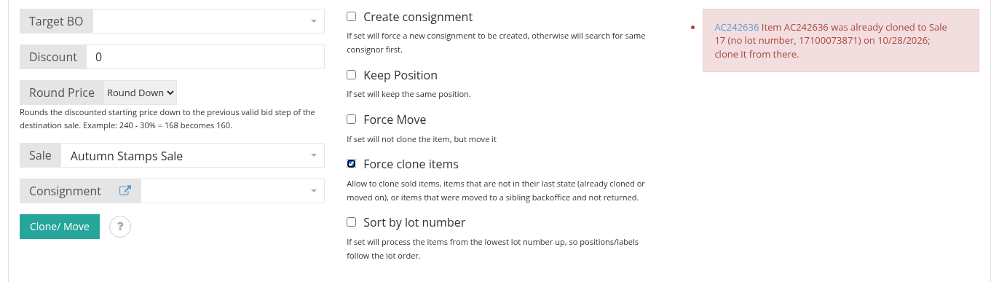
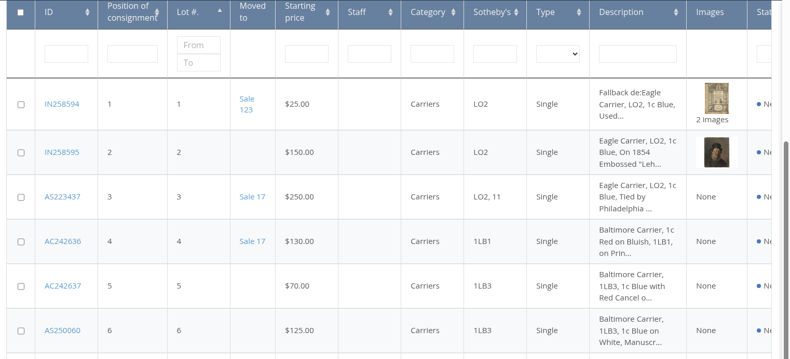

# Version 3.6

Upcoming release. Version 3.6 follows a lot wherever it goes: a lot that is cloned or moved to a later sale, sent to a sibling backoffice or brought back from one now shows its whole chain on the item page, in the family tree and in the items list, its history tab reads across backoffices, and the clone/move rules make sure a lot is always taken from its newest link. Clone and move batches run through the queue, one lot at a time, and report each result on the items page.

## Items

### The chain of an item on the item page and in the family tree

Every clone or move adds a link to the **chain** of a lot: the sales it was offered in and the backoffices it went to.

- On the item page, under the lot navigation, the chain is drawn as a row of boxes, oldest first, with the sale the item is open in highlighted. A darker box is a sibling backoffice. Each box opens the lot in that sale or on that backoffice.
- The item header shows **Cloned from** for a lot that came from another lot or from a sibling backoffice.
- In the **All Items (Family Tree)** tab of a consignment, the same chain is drawn in a row above each lot that travelled.
- A chain is the same from every link and on every backoffice: the backoffice asks its siblings for their part of the chain.

See [Clone or Move an Item Between Sales and Backoffices](../items/clone-move-between-sales-and-backoffices.md).

### Item history across backoffices

The **Item History** tab lists the history rows of every link of the chain. A row that records a move to or from a sibling backoffice carries the badge of the backoffice it belongs to next to the status and links to the lot on the other backoffice; when the backoffices are connected, the rows the sibling holds are fetched and listed too, with the sibling's badge. A new **Backoffice name** setting (Server Settings, General) names this backoffice on those badges.

### Clone and move rules, and Force clone items

A lot is cloned or moved only from the **newest link of its chain**, and only while it is still for sale:

- A lot that was already cloned on, or that left to a sibling backoffice, is refused with a message naming the newer lot and the day it was cloned, or the backoffice it went to.
- Only **Unsold** and **Up for sale** lots can be cloned or moved; a **Sold** lot is never moved, because its invoice would lose it.
- **Force clone items** lifts these rules for cloning only.
- The **Clone/ Move information** popover (the question mark next to the button) now lists these rules together with the conditions for a move.

Lots cloned before this version keep working: their old records are read into the chain when the backoffice is updated.

### Clone and move batches through the queue

Clone and move requests from the items list now run as one queue task per lot, in the order the lots were sent, on this backoffice as well as between sibling backoffices. The **Clone/ Move Item** block follows the batch live: pending, running, done and failed counters, and one line per lot with its result and a link to the new lot. A batch sent to a sibling backoffice waits there as "pending" until a user of that backoffice opens the clone page and releases it into a sale of their choice, with the consignment, discount and rounding options chosen there; an unreleased batch expires after seven days.

### Moved to column in the items list

A new **Moved to** column of the items list shows, in the sale context of a sale, where each lot went: empty for a lot that stayed, a link to the clone in the later sale, or the sibling backoffice it left to. Add `moved_to` to **List of column in item table** in the Server Settings to show it.

## Data migration

### Kelleher connected items

Lots that were offered again in a later AMS sale are now imported as links of the item chain instead of separate connected records, so migrated lots show the same chain, history rows and Moved to cells as lots cloned in the backoffice.
