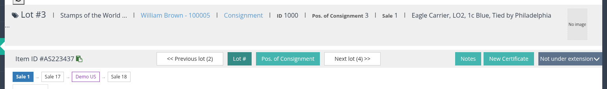
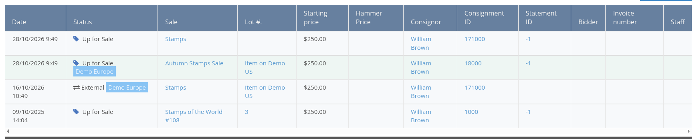
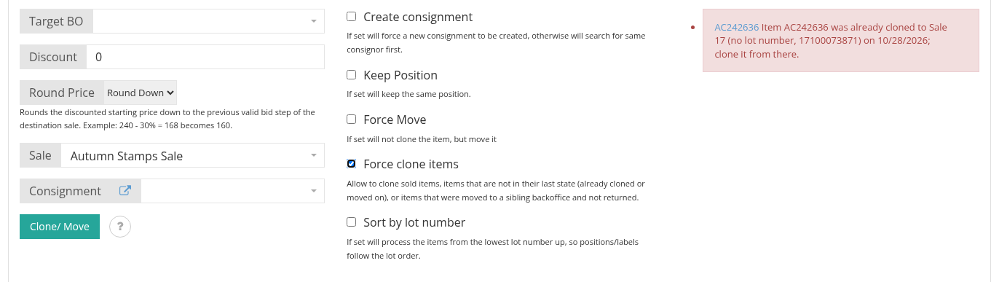
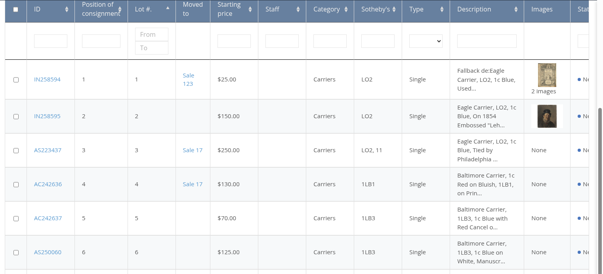
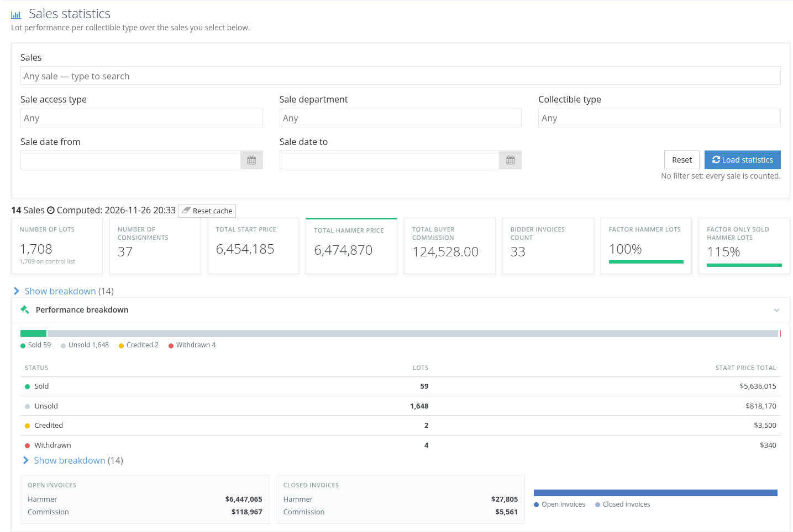
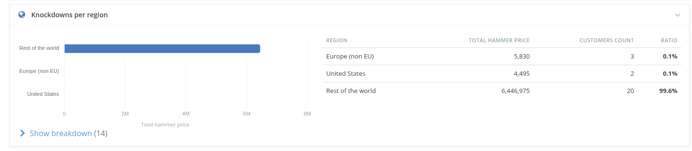
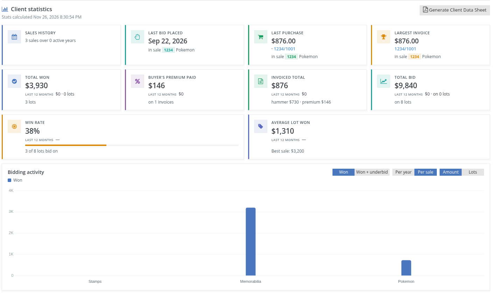
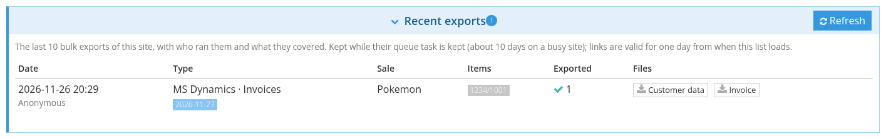
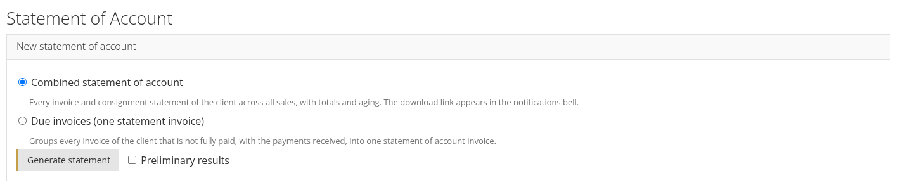

# Version 3.6

Upcoming release. Version 3.6 follows a lot wherever it goes: a lot that is cloned or moved to a later sale, sent to a sibling backoffice or brought back from one now shows its whole chain on the item page, in the family tree and in the items list, its history tab reads across backoffices, and the clone/move rules make sure a lot is always taken from its newest link. Clone and move batches run through the queue, one lot at a time, and report each result on the items page. On the reporting side, a new Sales statistics page adds up several sales at once, the client statistics show more figures, Export Accounting lists the recent exports with their files, and a client's open invoices can be summed up in one new statement of account.

## Items

### The chain of an item on the item page and in the family tree

Every clone or move adds a link to the **chain** of a lot: the sales it was offered in and the backoffices it went to.

- On the item page, under the lot navigation, the chain is drawn as a row of boxes, oldest first, with the sale the item is open in highlighted. A darker box is a sibling backoffice. Each box opens the lot in that sale or on that backoffice.
- The item header shows **Cloned from** for a lot that came from another lot or from a sibling backoffice.
- In the **All Items (Family Tree)** tab of a consignment, the same chain is drawn in a row above each lot that travelled.
- A chain is the same from every link and on every backoffice: the backoffice asks its siblings for their part of the chain.

See [Clone or Move an Item Between Sales and Backoffices](../items/clone-move-between-sales-and-backoffices.md).

### Item history across backoffices

The **Item History** tab lists the history rows of every link of the chain. A row that records a move to or from a sibling backoffice carries the badge of the backoffice it belongs to next to the status and links to the lot on the other backoffice; when the backoffices are connected, the rows the sibling holds are fetched and listed too, with the sibling's badge. A new **Backoffice name** setting (Server Settings, General) names this backoffice on those badges.

### Clone and move rules, and Force clone items

A lot is cloned or moved only from the **newest link of its chain**, and only while it is still for sale:

- A lot that was already cloned on, or that left to a sibling backoffice, is refused with a message naming the newer lot and the day it was cloned, or the backoffice it went to.
- Only **Unsold** and **Up for sale** lots can be cloned or moved; a **Sold** lot is never moved, because its invoice would lose it.
- **Force clone items** lifts these rules for cloning only.
- The **Clone/ Move information** popover (the question mark next to the button) now lists these rules together with the conditions for a move.

Lots cloned before this version keep working: their old records are read into the chain when the backoffice is updated.

### Clone and move batches through the queue

Clone and move requests from the items list now run as one queue task per lot, in the order the lots were sent, on this backoffice as well as between sibling backoffices. The **Clone/ Move Item** block follows the batch live: pending, running, done and failed counters, and one line per lot with its result and a link to the new lot. A batch sent to a sibling backoffice waits there as "pending" until a user of that backoffice opens the clone page and releases it into a sale of their choice, with the consignment, discount and rounding options chosen there; an unreleased batch expires after seven days.

### Moved to column in the items list

A new **Moved to** column of the items list shows, in the sale context of a sale, where each lot went: empty for a lot that stayed, a link to the clone in the later sale, or the sibling backoffice it left to. Add `moved_to` to **List of column in item table** in the Server Settings to show it.

## Reports & Statistics

### Sales statistics across several sales

A new **Sales statistics** page (sidebar, under Reports) adds up the lot performance of several sales at once.

- Pick the sales one by one, or filter them by **sale access type**, **sale department**, **collectible type** and **sale date** range, then click **Load statistics**. With no filter set, every sale is counted.
- Summary cards: number of lots (and lots on the control list), number of consignments, total start price, total hammer price, total buyer commission, bidder invoices count, and the hammer factor over all lots and over sold lots only.
- **Performance breakdown**: sold, unsold, credited and withdrawn lots with their start price totals, and the hammer and commission of open and closed invoices.
- **Performance by collectible type**: the same breakdown with one tab per collectible type.
- **Knockdowns per region**, **Turnover by Bidder Invoices** in price steps, and a **Categories breakdown** of single lots, collections and groups.
- Every block has a **Show breakdown** link that splits its figures per sale.
- Results are cached; the line above the cards shows when they were computed, and **Reset cache** computes them again.

### More client statistics

The **Statistics** tab of the client page shows more figures:

- New cards: **Sales history** (number of sales and active years), **Last bid placed**, **Last purchase** and **Largest invoice**, each with the sale and a link to the invoice, **Buyer's premium paid** and **Invoiced total** (split into hammer and premium).
- Total won, buyer's premium, invoiced total, total bid, win rate and average lot won now also show the figure for the **last 12 months**. Average lot won shows the best sale.

## Accounting

### Recent exports on Export Accounting

The **Export Accounting** page has a **Recent exports** panel above the filters. It lists the last 10 bulk exports of the site: the date and the user who ran it, the export type and export date, the sale, the exported invoices or statements, the number of exported items, and download links to the generated files. An export is listed as long as its queue task is kept (about 10 days on a busy site), and the file links are valid for one day from when the list loads. **Refresh** reloads the list.

See [Export to MS Dynamics](../tutorials/export-dynamics.md).

### New statement of account on the client page

The **Statement of Account** tab of the client page has a **New statement of account** panel with two choices:

- **Combined statement of account**: every invoice and consignment statement of the client across all sales, with totals and aging. The download link appears in the notifications bell.
- **Due invoices (one statement invoice)**: groups every invoice of the client that is not fully paid, with the payments received, into one statement of account invoice, so the client gets a summary of all their open invoices.

Tick **Preliminary results** to preview the statement before generating it.
